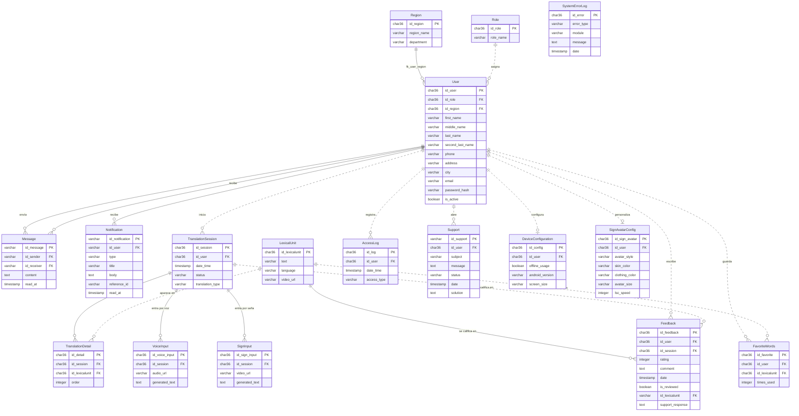

# 2. Diagrama relacional

GitHub dibuja este diagrama automáticamente (Mermaid). Para editarlo, cambia el bloque de código y el render se actualiza solo.

**Cómo leer las líneas:**

- **Línea continua** (`--`): la relación existe en la base como `FOREIGN KEY`.
- **Línea punteada** (`..`): la columna guarda el id, pero la base **no** la valida. Ver la observación 1 de la [contextualización](01-contextualizacion.md).

Para no ensuciar el dibujo se omiten `created_at`, `updated_at` y `deleted_at`, que tienen todas las tablas menos `Role` y `Message`.

## Vistas

| Vista | Lee de | La usa |
|---|---|---|
| `vw_users` | `User`, `Role`, `Region` | Listado de usuarios del administrador |
| `vw_user_dashboard` | `User`, `TranslationSession`, `FavoriteWords`, `Feedback`, `Support` | Panel del usuario |
| `vw_admin_dashboard` | Las mismas, agrupadas por usuario | Panel del administrador |
| `vw_system_statistics` | Conteos globales | Tarjetas de estadísticas |
